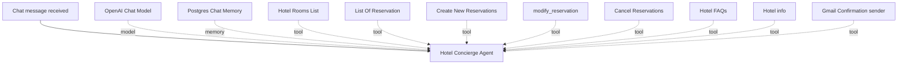

# AI Hotel Reception Agent

An n8n-based AI hotel concierge workflow designed to answer hotel questions and assist with reservation operations through a chat interface.

> **Status:** Portfolio/demo project. The workflow export describes the intended automation; it has not been independently executed or end-to-end tested as part of this repository preparation. Configure and test all integrations before real use.

## What it does

- Answers hotel FAQs and retrieves hotel information from Google Sheets.
- Looks up room inventory and reservation records before discussing availability.
- Supports the intended reservation lifecycle: create, modify, cancel, and look up reservations.
- Uses booking rules for date validation, guest capacity, stay length, and total-price calculation.
- Requires explicit guest confirmation before creating, modifying, or cancelling a reservation.
- Sends email confirmations through Gmail after a reservation action succeeds.
- Uses Postgres Chat Memory for conversational context.
- Escalates complaints, refunds, payment issues, safety issues, and cases the agent cannot verify to hotel staff.

## Stack

- n8n
- n8n AI Agent / LangChain nodes
- OpenAI Chat Model (`gpt-5-mini` in the supplied export)
- Google Sheets
- Gmail
- Postgres Chat Memory

## Workflow at a glance



## Repository layout

```text
.
├── README.md
├── workflow/
│   └── hotel-reception-agent-sanitized.json
├── docs/
│   └── workflow-explanation.md
├── examples/
│   └── sample-conversation.md
├── screenshots/
│   └── .gitkeep
└── .gitignore
```

## Setup

1. Install or access an n8n instance that supports the node types used in this workflow.
2. Download `workflow/hotel-reception-agent-sanitized.json` and import it into n8n.
3. Open each Google Sheets tool node and select your own hotel spreadsheet and the correct tabs.
   - The placeholder `REPLACE_WITH_YOUR_GOOGLE_SHEETS_DOCUMENT_ID` is intentional.
   - Do not publish your real spreadsheet ID if the sheet is private.
4. Connect your own OpenAI, Google Sheets, Gmail, and Postgres credentials in n8n.
5. Check the Postgres Chat Memory configuration and choose the appropriate database settings for your environment.
6. Verify the spreadsheet tabs and column names match the fields used in the workflow.
7. Review the system prompt and replace the demo hotel policies with the real property's approved policies.
8. Test every reservation path with dummy data before enabling the workflow for users.

## Data expectations

The supplied workflow references Google Sheets tabs for `Rooms`, `Reservation`, `Hotel_FAQ`, and `Hotel_Info`.

The prompt and node mappings reference these room fields: `room_id`, `room_type`, `capacity`, `price_per_night`, and `description`.

The reservation mapping references fields including `reservation_id`, `room_id`, `room_type`, `guest_name`, `guest_email`, `guest_phone`, `check_in`, `check_out`, `guests`, `total_price`, `status`, `notes`, and `created_at`. Check the workflow nodes and your own spreadsheet before testing; the export does not fully define the schemas for every tab.

## Important safety and production notes

- The workflow contains demo hotel policies. Replace them before production.
- The agent's instructions require verifying room availability and capacity, confirming booking details with the guest, and re-checking availability immediately before creating a reservation.
- The workflow's instructions are not a substitute for testing. Validate tool behavior and failure handling in your own n8n instance.
- A final availability re-check reduces double-booking risk but does not guarantee atomic booking. For production, use a transactional booking system or another concurrency-safe reservation mechanism.
- Use only test guest data while developing.
- Never commit API keys, OAuth tokens, credentials, private guest data, or real private spreadsheet links.
- The exported workflow has been sanitized for this repository: credential bindings and webhook IDs have been removed, spreadsheet references have been replaced with placeholders, and the workflow is inactive by default.
- Review the sanitized JSON before importing. You must reconnect credentials and configure integrations.

## Testing checklist

- [ ] Hotel FAQ and general information queries
- [ ] Room search with capacity validation
- [ ] Available and unavailable date ranges
- [ ] Check-in/check-out validation and night calculation
- [ ] Booking summary and explicit confirmation before creation
- [ ] Re-check availability before creating a reservation
- [ ] Reservation lookup requires both reservation ID and matching guest email
- [ ] Modification shows old and new details and requires confirmation
- [ ] Cancellation requires verification and explicit confirmation
- [ ] Email is sent only after the reservation action succeeds
- [ ] Invalid input, unavailable integrations, and human handoff scenarios
- [ ] No guest data or secrets appear in logs or repository files

## License

No license has been selected yet. Add a license file before inviting others to reuse or redistribute this project.
